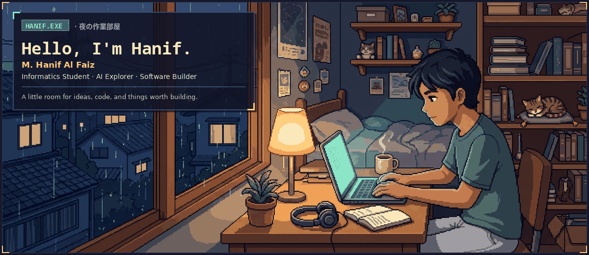
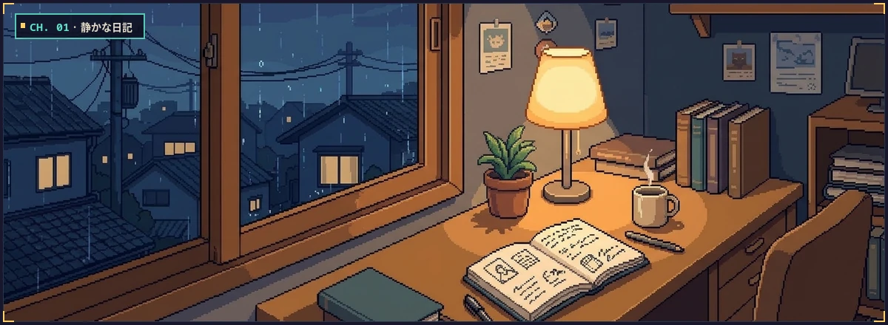
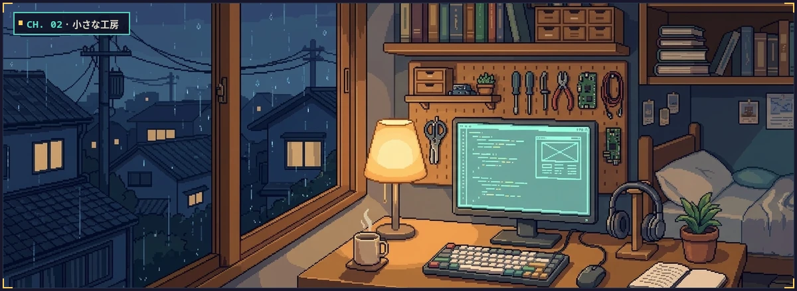
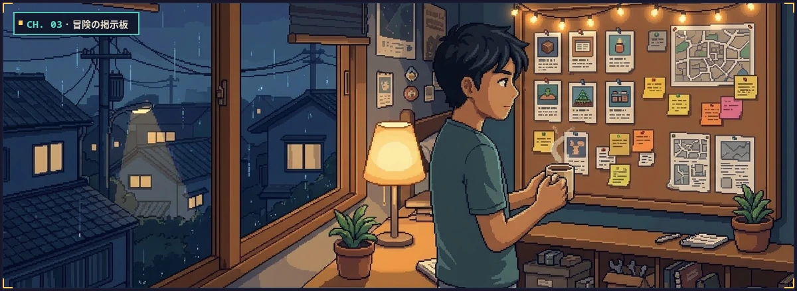
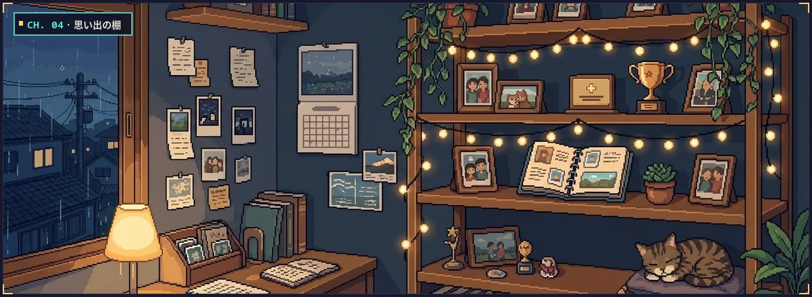
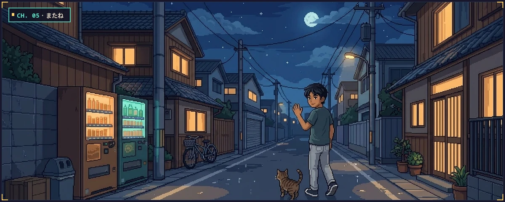

<p align="center">
  <picture>
    <source media="(prefers-reduced-motion: reduce)" srcset="./hero-room.webp" />
    
  </picture>
</p>

<p align="center">
  <a href="https://hanif-exe.vercel.app"><strong>Explore My Portfolio</strong></a>
  &nbsp;&nbsp;·&nbsp;&nbsp;
  <a href="https://hanif-exe.vercel.app/projects"><strong>View My Projects</strong></a>
  &nbsp;&nbsp;·&nbsp;&nbsp;
  <a href="https://www.linkedin.com/in/hanif-faiz-05b36b31a"><strong>Connect With Me</strong></a>
</p>

<p align="center">
  
</p>

## 01 / The Person Behind the Screen

<p align="center">
  
</p>

Hi, I'm **M. Hanif Al Faiz** — known online as **HANIF.EXE**. I'm an Informatics Engineering student at **Telkom University Purwokerto**, Indonesia, who enjoys turning late-evening ideas into thoughtful, practical software.

Most of what I build sits at the intersection of **artificial intelligence, civic technology, and full-stack web applications**. I care about making technology genuinely useful for everyday people — whether that means helping small businesses understand their electricity bills, prototyping smart-city simulations, or building tools for local communities. I love learning in public, collaborating across disciplines, and approaching every project with curiosity and care.

```yaml
# developer_journal.yml
name:     M. Hanif Al Faiz (HANIF.EXE)
location: Purwokerto, Indonesia
study:    Informatics Engineering
          Telkom University Purwokerto (2027)
focus:
  - AI & AI Agents
  - Civic Tech & Smart Cities
  - Full-Stack Software & Applied Research
motto:    "Code. Lead. Build. Explore."
```

<p align="center">
  
</p>

## 02 / Tools on My Desk

<p align="center">
  
</p>

The languages, frameworks, and tools I reach for most often across coursework, prototypes, and research experiments:

| Shelf | Equipment & Stack |
| :--- | :--- |
| **Languages** | `Python` · `TypeScript` · `JavaScript` · `Java` · `C` · `C++` · `Go` · `PHP` · `SQL` |
| **Web & App Development** | `React` · `Next.js` · `Vite` · `Tailwind CSS` · `HTML5 & CSS3` · `Leaflet` · `Drizzle ORM` · `Laravel` · `Vue` |
| **AI, Data & Intelligent Systems** | `NumPy` · `Pandas` · `Matplotlib` · `Jupyter Notebook` · `Fuzzy Logic` · `ONNX Runtime Web` · `Tesseract.js (OCR)` · `AI Agents` |
| **Developer Tools & Databases** | `Git` · `GitHub` · `PostgreSQL` · `MySQL` · `Docker` · `Figma` · `VS Code` · `Android Studio` |

<p align="center">
  
</p>

## 03 / Little Projects, Big Ideas

<p align="center">
  
</p>

A few selected builds from my workshop — ranging from early startup MVPs and smart-city simulations to local community prototypes and academic experiments.

| Project | Purpose | Tech Stack | Status & Note |
| :--- | :--- | :--- | :--- |
| **[WattWise AI](https://github.com/hanif-12-01/start-up-repo)** | Electricity cost intelligence, meter OCR, and usage forecasting built for Indonesian small businesses. | Next.js, React, TypeScript, Tailwind CSS, PostgreSQL, Drizzle ORM, ONNX Runtime Web, Tesseract.js, Laravel, Vue | **Active MVP / Pilot Validation**<br/><sub>Top 10 Finalist — PLN ICE 2026</sub> |
| **[CIVICTWIN Semarang](https://github.com/hanif-12-01/Unity-semarang)** | Smart-city civic intelligence and urban scenario simulation prototype focused on Semarang. | React, TypeScript, Vite, Tailwind CSS, Leaflet | **Prototype / Simulation**<br/><sub>3rd Place — UNITY UNY 2026</sub> |
| **[Purwokerto Intelligence Layer](https://github.com/hanif-12-01/Purwokerto-intelligence-layer)** | Geospatial visualization and civic policy experimentation prototype for Purwokerto. | React, TypeScript, Vite, Tailwind CSS, Leaflet | **Research Experiment** |
| **[Lapor Mangan!](https://github.com/hanif-12-01/LAPORMANGAN)** | Local food discovery and UMKM-oriented culinary web prototype for Purwokerto. | JavaScript, HTML5, CSS3, Leaflet, Open-Meteo API | **Completed Prototype** |
| **[Bernas MBG](https://github.com/hanif-12-01/Bernas-MBG)** | Multi-role meal distribution monitoring proof of concept. | React, JavaScript, Tailwind CSS, Python | **Proof-of-Concept Prototype** |
| **[Fuzzy Rain Risk Index](https://github.com/hanif-12-01/Tubes-Dasar-Kecerdasan-Artificial)** | Python-based fuzzy inference experimentation for rainfall risk modeling. | Python, Jupyter Notebook, NumPy, Pandas, Matplotlib, Fuzzy Logic | **Academic Experiment** |

<p align="center">
  <a href="https://hanif-exe.vercel.app/projects"><strong>Browse the full project archive on HANIF.EXE →</strong></a>
</p>

<p align="center">
  
</p>

## 04 / Memories & Little Victories

<p align="center">
  
</p>

Every competition, research project, and student organization has been a chance to learn from great teammates and grow a little further:

- **3rd Place — UNITY UNY 2026 Smart City Competition** · Built the *CIVICTWIN Semarang* smart-city simulation prototype.
- **Top 10 Finalist — PLN ICE 2026 Startup Competition** · Developed *WattWise AI* for small-business electricity cost intelligence (PT PLN Persero).
- **Top 5 Finalist — GenBI Business Plan Competition 2026** · Recognized in the business plan finals (Generasi Baru Indonesia).
- **YIA KPP Mining Project Grant Recipient** · Supported by Yayasan Inspirasi Anak Bangsa & PT Kalimantan Prima Persada.
- **Applied Research & PKM** · Contributed to 2 faculty community service (PKM) programs, 1 faculty research project, PKM Data Science presentation, and PKM-K.
- **Leadership & Community** · Served as Secretary of BEM KEMA, Project Lead / OC Chair for the Responsive Program, Host/MC & Secretary for TULC Season 2, Education Member at Satria Muda, and active member across HMIF & HIMA Informatics.

<p align="center">
  
</p>

## 05 / Until Next Time

<p align="center">
  
</p>

<p align="center">
  Thanks for visiting my little corner of the internet.<br/>
  I'm always learning, building, and looking for meaningful things to create.<br/>
  <strong>Have an idea? Let's make something together.</strong>
</p>

<p align="center">
  <a href="https://hanif-exe.vercel.app"><strong>Portfolio</strong></a>
  &nbsp;&nbsp;·&nbsp;&nbsp;
  <a href="https://github.com/hanif-12-01"><strong>GitHub</strong></a>
  &nbsp;&nbsp;·&nbsp;&nbsp;
  <a href="https://www.linkedin.com/in/hanif-faiz-05b36b31a"><strong>LinkedIn</strong></a>
  &nbsp;&nbsp;·&nbsp;&nbsp;
  <a href="mailto:mhanifalfaiz@student.telkomuniversity.ac.id"><strong>Email</strong></a>
</p>

<p align="center">
  
</p>
