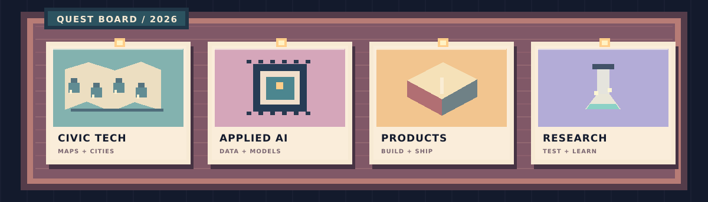
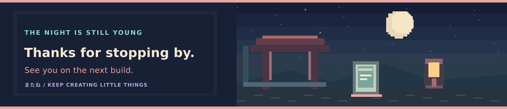

<div align="center">


<br>

<sub>夜の作業部屋 · A little room for ideas, experiments, and meaningful software.</sub>

<p>
  <a href="https://hanif-exe.vercel.app"><strong>↗ Visit my pixel portfolio</strong></a>
  &nbsp; · &nbsp;
  <a href="https://github.com/hanif-12-01?tab=repositories">Explore repositories</a>
  &nbsp; · &nbsp;
  <a href="https://www.linkedin.com/in/hanif-faiz-05b36b31a">Say hello</a>
</p>

</div>

---

## 01 / The person behind the screen ☕

> *A warm desk lamp, a notebook full of ideas, and probably too many browser tabs.*

Hey there! I'm **M. Hanif Al Faiz**, an Informatics Engineering student at **Telkom University Purwokerto, Indonesia**.

I spend my time exploring **artificial intelligence, software engineering, smart cities, and digital products**. What I enjoy most is turning a real-world problem into something people can actually use — whether that's a civic dashboard, an AI prototype, or a small web experiment.

Outside of coding, I enjoy joining competitions, collaborating with teams, learning new things, and connecting technology with community impact. My personal rule is simple: **build something, learn from it, then make it better.**

```yaml
player: M. Hanif Al Faiz
alias: HANIF.EXE
home_base: Indonesia
class: Informatics Student / Curious Builder
currently_exploring:
  - Artificial Intelligence & AI Agents
  - Civic Tech & Smart Cities
  - Full-Stack Applications
  - Data, Research & Product Thinking
side_quest: Make technology a little more useful.
```

<div align="center">
  <sub>✦ Code. Lead. Build. Explore. ✦</sub>
</div>

---

## 02 / The quest board — things I've built 🗺️

Some projects are experiments, some are competition prototypes, and some are ideas I'm still growing. Each one teaches me something different.

<div align="center">

</div>

<table>
<tr>
<td width="50%" valign="top">

### ⚡ WattWise AI
**Electricity intelligence · AI + product**

A decision-support prototype for electricity usage and costs, combining meter OCR, consumption insights, and in-browser load forecasting.

<sub>Next.js · TypeScript · PostgreSQL · ONNX</sub>

<a href="https://github.com/hanif-12-01/start-up-repo">↗ Explore project</a>

</td>
<td width="50%" valign="top">

### 🏙️ CIVICTWIN Semarang
**Civic intelligence · Smart city**

A competition proof-of-concept for urban priorities, simulated citizen feedback, and policy exploration.

<sub>React · TypeScript · Leaflet · Vite</sub>

<a href="https://github.com/hanif-12-01/Unity-semarang">↗ Explore project</a>

</td>
</tr>
<tr>
<td width="50%" valign="top">

### 🗺️ Purwokerto Intelligence Layer
**GIS + policy simulation**

Experimental geospatial civic dashboard with thematic maps, simulated indicators, and dynamic priority weighting.

<sub>React · TypeScript · Leaflet · MCDM</sub>

<a href="https://github.com/hanif-12-01/Purwokerto-intelligence-layer">↗ Explore project</a>

</td>
<td width="50%" valign="top">

### 🌿 EcoThread
**Circular fashion · Digital product**

A GEMASTIK XIX project exploring upcycled fashion, UMKM production workflows, and Digital Product Passports.

<sub>TypeScript · React · Fastify · Prisma</sub>

<a href="https://github.com/hanif-12-01/Gemastik-XIX-">↗ Explore project</a>

</td>
</tr>
<tr>
<td width="50%" valign="top">

### 🌾 PanganNadi Adaptive
**Decision support · Food logistics**

A hackathon prototype exploring food-price risk, constrained distribution planning, and human-approved decisions.

<sub>Python · FastAPI · React · OR-Tools</sub>

<a href="https://github.com/hanif-12-01/Hackathon-seno-ITS">↗ Explore project</a>

</td>
<td width="50%" valign="top">

### 🍜 Lapor Mangan!
**Local discovery · Web**

A Purwokerto culinary discovery prototype supporting local UMKM with maps, weather-aware suggestions, and a rule-based assistant.

<sub>JavaScript · HTML/CSS · Leaflet</sub>

<a href="https://github.com/hanif-12-01/LAPORMANGAN">↗ Explore project</a>

</td>
</tr>
</table>

<div align="center">

**[Explore the full project collection →](https://hanif-exe.vercel.app/projects)**

</div>

---

## 03 / Tools on my desk 🧰

I choose technologies based on the problem, not just the trend. These are some of the languages and tools I've worked with across projects and coursework.

<div align="center">


<br>

<sub>AI & data experiments · Frontend & backend · GIS · Databases · Software fundamentals</sub>

</div>

---

## 04 / Side quests, research & little victories ✨

The fun part isn't just writing code. It's taking ideas into the real world, presenting them, and learning from other people.

- 🥉 **3rd Place — UNITY UNY 2026 Smart City Competition**, with the CIVICTWIN Semarang prototype.
- 💡 **Top 10 Finalist — PLN ICE 2026 Startup Competition**, with WattWise AI.
- 🔬 **Research explorations** include [THERMOBREATH](https://github.com/hanif-12-01/THERMOBREATH), a breath-sensing research and machine-learning workspace, and [SafeTrace Lite](https://github.com/hanif-12-01/SafeTrace-Lite), an FPGA security design proposal and functional reference model.
- 🤝 **Teamwork and leadership** through competitions, campus organizations, and collaborative product experiments.

<div align="center">
  <sub>Still learning. Still experimenting. There's always another quest.</sub>
</div>

---

## 05 / Leave a note before you go 💌

Whether it's an AI experiment, a collaboration, an interesting product idea, or just a conversation about technology — I'd love to connect.

<div align="center">

<a href="mailto:mhanifalfaiz@student.telkomuniversity.ac.id">✉️ Email</a>
&nbsp; · &nbsp;
<a href="https://www.linkedin.com/in/hanif-faiz-05b36b31a">LinkedIn</a>
&nbsp; · &nbsp;
<a href="https://hanif-exe.vercel.app">HANIF.EXE Portfolio</a>
&nbsp; · &nbsp;
<a href="https://github.com/hanif-12-01">GitHub</a>

<br><br>



<sub>Original pixel artwork made for this README · Inspired by quiet Japanese evenings and indie RPG worlds.</sub>

</div>
